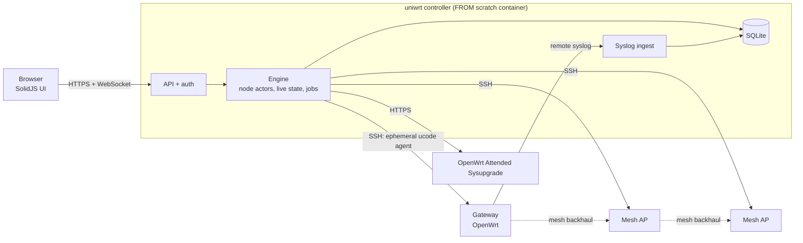

<div align="center">

# uniwrt

**A UniFi-class controller for OpenWrt mesh networks.**

Adopt, configure, visualize, troubleshoot and upgrade every OpenWrt router in your home from one fast, modern web app.

[](#license)

</div>

> [!NOTE]
> **Status: early development.** The plan is complete and the foundation (M0) is being built. Track progress in [docs/STATUS.md](docs/STATUS.md) and [docs/ROADMAP.md](docs/ROADMAP.md).

## Why

OpenWrt is the best firmware you can run on a router. Running *several* OpenWrt routers as one home mesh is harder: you SSH into each one, hand-edit UCI files, keep Wi-Fi, roaming and mesh settings consistent by yourself, and never get a single view of what is connected where. uniwrt brings the single-pane-of-glass experience of commercial controllers to OpenWrt, without lock-in and without the cloud.

## Highlights (planned)

- **Adopt in minutes.** Watch your existing nodes read-only first. Add new devices with zero-touch firmware images, a bench adoption port, or a one-line bootstrap.
- **Mesh made easy.** batman-adv over encrypted 802.11s, with automatic failover between wired and wireless backhaul and VLANs carried across the mesh.
- **Seamless roaming.** 802.11r/k/v with controller-distributed neighbor reports, plus band and AP steering.
- **Automatic RF planning.** Channel, width and transmit power chosen from real scans and node-to-node measurements, with an explainable score and coordinated changes.
- **Options-based ISP setup.** Presets such as Lumen/Quantum Fiber IPoE (VLAN 201), PPPoE, 6rd or DHCPv6-PD, plus a live connectivity test before anything is committed.
- **See everything.** A live animated topology, which client is on which node, a roaming timeline, a spectrum view and a floor-plan coverage heatmap.
- **Troubleshoot fast.** Searchable logs aggregated from every node, metrics, events and alerts. Run ping, traceroute, iperf3 or a packet capture from any node. A per-client "connection doctor" and a WAN quality monitor round it out.
- **Safe changes.** Every change is reviewed as a per-node diff and applied as a transaction. If a node loses contact, it rolls back automatically. Full revision history.
- **Rolling upgrades.** Firmware is built with each node's exact package set (Attended Sysupgrade). Nodes upgrade one at a time, from the edge of the mesh to the gateway, with health checks between steps.
- **Never SSH again.** DHCP, DNS, firewall, port forwards, WireGuard, SQM, DDNS and schedules. A built-in browser terminal and raw UCI editor cover the rare edge case.
- **Tiny and fast.** One static Rust binary with the UI embedded, shipped as a `FROM scratch` image for amd64, 386, arm/v7 and arm64.

## How it works



- The controller keeps one SSH session open per node and runs an **ephemeral ucode agent** over it. (ucode is the scripting runtime built into OpenWrt.) The agent speaks JSON-RPC and pushes events in real time. It installs nothing permanent and works on every CPU architecture.
- The controller owns the **desired state**. It renders each node's UCI config, diffs it against the node, and applies it as a **transaction**. A dead-man timer on the node rolls the change back if the controller can't confirm it.
- Logs arrive through OpenWrt's built-in remote syslog. Firmware images come from OpenWrt's Attended Sysupgrade service.

Details: [docs/ARCHITECTURE.md](docs/ARCHITECTURE.md).

## Quick start (after the first release)

```sh
docker run -d --name uniwrt --restart unless-stopped \
  --network host -v uniwrt-data:/data \
  ghcr.io/robertzas/uniwrt:latest
```

Then open `https://<host>:8443`. Host networking is recommended because it makes discovery and log ingest simple. With bridge networking, publish `8443/tcp` and `5514/tcp+udp` instead.

## Compatibility

| | Supported |
|---|---|
| Controller host | Any Linux container host: x86_64, x86 (i686), arm32 (armv7), arm64 |
| Managed nodes | OpenWrt 25.12 (primary target) and 24.10 (best effort), on any CPU architecture |
| Scale | Designed for 1–50 nodes and up to 1,000 clients; tuned on a gateway plus 3 APs |

## Documentation

| Doc | Contents |
|---|---|
| [PRODUCT](docs/PRODUCT.md) | Vision, scope, principles, capability catalog |
| [ARCHITECTURE](docs/ARCHITECTURE.md) | Components, node protocol, data flow, persistence, budgets |
| [ROADMAP](docs/ROADMAP.md) · [STATUS](docs/STATUS.md) | Milestones and work packages · current progress |
| [DECISIONS](docs/DECISIONS.md) | Accepted decisions and open options |
| [features/](docs/features/) | Specs: adoption, WAN/ISP, networks, Wi-Fi & RF, mesh, observability, lifecycle, UI, security |
| [dev/](docs/dev/) | Conventions, build & release, testing |
| [AGENTS.md](AGENTS.md) | Working agreement for AI coding agents |

## Contributing

uniwrt is in early development, and issues and ideas are welcome. Start with [docs/dev/CONVENTIONS.md](docs/dev/CONVENTIONS.md). Commits follow [Conventional Commits](https://www.conventionalcommits.org/), and every push to `main` ships a release.

## License

Licensed under either the [Apache License 2.0](LICENSE-APACHE) or the [MIT license](LICENSE-MIT), at your option. Unless you explicitly state otherwise, any contribution you intentionally submit for inclusion in this work, as defined in the Apache-2.0 license, is dual-licensed as above, without any additional terms or conditions.

*uniwrt is an independent project, not affiliated with Ubiquiti Inc. or the OpenWrt project. UniFi is a trademark of Ubiquiti Inc.*
