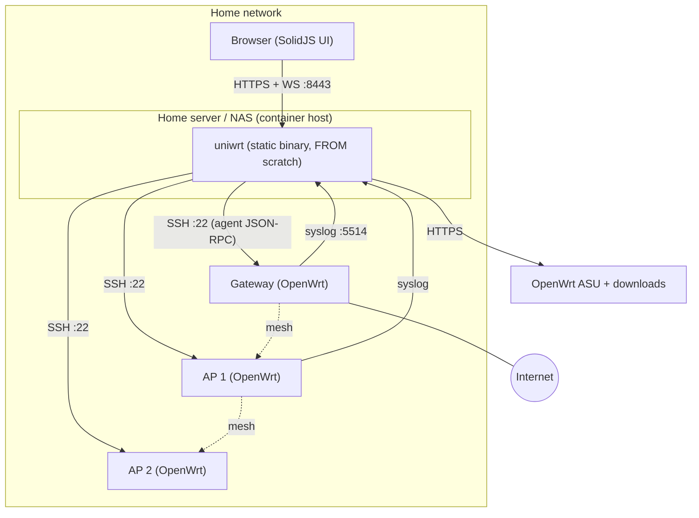

# Architecture

Read this when you touch crate boundaries, the node protocol, data flow, persistence or performance budgets. Feature-level design lives in [features/](features/).

## System context



## Principles

1. **Pure core, thin IO shell.** Rendering, diffing, planning and topology are pure functions over data: deterministic and snapshot-tested. IO lives only in adapter crates.
2. **Desired state in, transactions out.** There are no ad-hoc config changes. Every change goes through render → diff → review → transaction → verify.
3. **Data-plane independence.** The controller is never in the packet path, so the network keeps working while it is down. Steering and rollback fail safe.
4. **Capabilities over versions.** Render from detected capabilities (DSA vs swconfig, wpad variant, apk vs opkg), not from version strings.
5. **Explainable automation.** Every job step and automatic decision emits an event that includes its reason.
6. **One binary, zero runtime dependencies.** It runs in `FROM scratch`.

## Process structure (one binary)

- **HTTP server** (axum): REST under `/api/v1`, a WebSocket at `/api/v1/ws`, the embedded UI and the ZTP endpoints.
- **Engine:** one **NodeActor** (tokio task) per node. It owns the node's SSH link, agent session, live facts and command queue, and is supervised with backoff.
- **Event bus:** tokio broadcast of typed `Event`s. Consumers are the WS hub, the metrics writer, the alert engine and the store.
- **Job runner:** persisted state machines (adopt, apply, upgrade, rf-apply, backup) that resume after a restart. A per-node lock allows only one job per node at a time.
- **Store:** SQLite in WAL mode, with one batched writer task and a read pool.
- **Syslog receiver:** UDP and TCP listeners → parser → store, plus a live-tail topic.
- **Schedulers:** retention, backups, the RF optimizer, firmware checks and alert evaluation.

## Crates and layering

| Layer | Crate | Responsibility | May depend on |
|---|---|---|---|
| L0 pure | `core` | IDs, MAC/IP/prefix types, error conventions, `Clock` trait | — |
| L0 | `model` | desired state (`SiteConfig`), observed facts (`NodeFacts`, capabilities), the node record, validation, schema migrations | core |
| L0 | `uci` | UCI AST, parser, serializer, semantic diff | core |
| L0 | `render` | (SiteConfig, facts) → per-node UCI packages | core, model, uci |
| L0 | `topo` | facts → topology graph | core, model |
| L0 | `rf` | channel/width/power planner | core, model |
| L0 | `isp` | ISP preset schema and embedded presets (`crates/isp/data/`) | core, model |
| L1 adapters | `store` | SQLite: revisions, inventory, events, jobs, metrics, logs (FTS5), vault | core, model |
| L1 | `node` | SSH transport (russh), agent protocol, `NodeLink` trait, embedded agent bundle | core, model |
| L1 | `syslog` | RFC 3164/5424 receiver and parser | core |
| L1 | `firmware` | release catalog, ASU client, image cache and verification | core, model |
| L2 services | `engine` | node actors, telemetry ingest, live state, event bus, alerts, schedulers | L0, L1 |
| L2 | `jobs` | persisted orchestrations: adopt, apply, upgrade, rf-apply, backup | L0, L1, engine |
| L3 interface | `api` | axum REST + WebSocket, DTOs (ts-rs), auth and sessions | L0–L2 |
| L3 | `server` (bin `uniwrt`) | CLI, config, composition root, embedded UI, TLS | all |
| test | `sim` | simulated fleet implementing `NodeLink` (demo mode, tests) | core, model, node |

Rules:
- Dependencies point only to the same layer or a lower one.
- L0 crates do not depend on tokio and perform no IO. `just arch-check` enforces this (M1.9).
- A crate is created when its first WP starts, not before.
- Packages are named `uniwrt-<crate>` (a library named `core` would shadow Rust's `core`); directories keep the short name.

## Node protocol (D-003: SSH + ephemeral ucode agent)

**Transport.** A russh client with an ed25519 controller key. The node's host key is pinned at adoption: `probe` reads it, the user confirms the fingerprint, and every connection checks the pin (D-032). Keepalive every 15 s, and 3 unanswered ones end the session; on disconnect, reconnect with jittered exponential backoff (1 s → 60 s). One connection per node carries multiplexed channels: the agent, ad-hoc exec, uploads and the browser terminal. Each channel is drained by its own task, so a slow reader cannot stall the others. Commands are argv arrays, quoted for the node's shell.

**Bootstrap on every connection** (`crates/node/src/bundle.rs`):
1. Run `cat /tmp/uniwrt/agent/VERSION`. If it isn't the embedded bundle's hash (the SHA-256 of its SHA256SUMS), stream the bundle, an uncompressed tar, through stdin into a fixed install script. The script makes `/tmp/uniwrt` root's and private, takes a `flock`, extracts into `.new`, checks every file with `sha256sum -c` and swaps the result in. Nothing depends on sftp or scp.
2. Open a long-lived channel running `ucode /tmp/uniwrt/agent/main.uc`.
3. The agent's first line is `{"hello":{"proto":1,"agent":"<hash>","release":"25.12.6","caps":{"events":true,"ops":[…],"sets":[…]}}}`. A hash other than the bundle's fails the start.

**Agent runtime (D-034).** With ucode-mod-uloop (in 25.12 images, and in Wi-Fi images since 23.05 through hostapd), a forked reader task feeds requests into an event loop, and each command runs in a task of its own. Without it, requests are served one at a time and the agent pushes no events. A command's output goes to files under `/tmp/uniwrt/run`, never to the agent's stdout. Collect sets return raw sources (ubus replies, sysfs text, `/proc` files), and the `node` crate parses them into `model::facts`.

**Messages** are newline-delimited JSON:

```jsonc
// controller → agent
{"id":7,"op":"collect","args":{"sets":["system","stations"]}}
{"id":8,"op":"ubus","args":{"path":"hostapd.phy1-ap0","method":"rrm_nr_set","data":{"list":[]}}}
{"id":9,"op":"exec","args":{"argv":["batctl","o"],"timeout_ms":5000}}
{"id":10,"op":"subscribe","args":{"topics":["hostapd","netifd","dhcp"]}}
// agent → controller
{"id":7,"ok":{}}
{"id":9,"err":{"code":"timeout","msg":"batctl did not exit within 5000 ms"}}
{"ev":"hostapd.assoc","ts":1761091200123,"data":{"ifname":"phy1-ap0","mac":"aa:bb:cc:dd:ee:ff"}}
{"tick":{"system":{}}}
```

- **Ops:** `hello`, `ping`, `collect`, `ubus`, `exec` (an argv array with a timeout and bounded output), `read_file` (M1.3); `subscribe`/`unsubscribe`, `log_follow`, `set_interval` (M1.3c); `txn`, which delegates to the transaction tool (M3). Failures carry a code: `bad_request`, `not_found`, `timeout`, `too_large`, `denied`, `unsupported` or `failed`.
- **Source of truth:** `crates/node/src/proto.rs` and `proto/ops.rs`, mirrored by `node-agent/proto.uc` and `ops.uc`. The `proto` integer bumps on breaking changes; the controller supports the current version and the previous one.
- **Jump hosts:** a `direct-tcpip` channel through an adopted node reaches isolated segments, such as the adoption port described in features/adoption.md.

**Node footprint:**

| Mode | Persistent changes on the node |
|---|---|
| Observe | One `authorized_keys` entry (comment `uniwrt-controller`). Remote syslog only with consent. |
| Managed | Adds `/etc/uniwrt/` (transaction journal and snapshots, ≤ 100 KB), `/etc/init.d/uniwrt-guard` (rolls back unconfirmed transactions after an unexpected reboot), `/lib/upgrade/keep.d/uniwrt`, and the managed UCI packages. |

Everything else is ephemeral, under `/tmp/uniwrt` (RAM).

## Data flows

- **Telemetry:** the agent's ticks and events → the `node` crate parses them into `model::facts` → the NodeActor updates live state → the event bus fans out to the WS hub (at most 10 deltas/s per topic), the batched metrics writer, the alert engine and the snapshot writer.
- **Change:** UI edits → a staged `SiteConfig` revision → pure render per node → semantic diff against a freshly fetched node config → review → apply job (ordered per-node transactions) → verify over a new SSH connection, with health checks → confirm → events. Details: features/lifecycle.md.

## Persistence

- One SQLite database in WAL mode at `/data/uniwrt.db` (mode 0600), owned by the `store` crate (D-031). One writer thread holds the only write connection and commits queued operations in batches of up to 256, each in its own savepoint so that a failing one rolls back alone; callers get their result once the batch commits. Reads use up to 4 read-only connections on tokio's blocking pool. With `synchronous=NORMAL`, a power loss may drop the last commits but never corrupts the database.
- Tables (sketch; ✓ = exists): `users`, `sessions`, `api_tokens`, `settings`, `vault` ✓ (secrets; unencrypted `alg = 'plain'` rows until M1.6 seals them, D-032), `node_host_keys` ✓ (the pinned SSH host key per node), `revisions` (SiteConfig JSON + metadata), `nodes` ✓, `node_facts` ✓ (the latest NodeFacts JSON per node), `node_configs` (last fetched UCI per package + hash), `clients`, `client_sessions` (association and roam history), `events`, `jobs`, `job_steps`, `metrics_raw`/`_1m`/`_1h`, `logs` + `logs_fts` (FTS5), `backups`, `firmware_cache`, `ztp_requests`.
- Migrations are embedded from `crates/store/migrations/NNNN_name.sql`, forward-only (tracked in `PRAGMA user_version`; a database from a newer uniwrt is refused) and tested. A released migration is never edited.
- Files: `/data/backups/`, `/data/firmware/`, `/data/tls/`, `/data/master.key` (mode 0600).

## API

- REST JSON under `/api/v1`: auth, site, revisions, changes (pending/review/apply), nodes, clients, networks, wlans, topology, metrics, logs, events, jobs, firmware, isp-presets, tools, settings.
- Errors use RFC 9457 problem+json. Pagination is cursor-based.
- Auth: a session cookie for the UI, or a bearer API token for scripts.
- WebSocket `/api/v1/ws`: the client sends `{"sub":["fleet","node:<id>","topology","logs?node=<id>&min=warning"]}`. The server answers with a snapshot, then batched deltas. Viewing an entity raises its telemetry rate (adaptive polling).
- Types: Rust DTOs derive `TS` with `#[ts(export)]`, and `cargo test` (or `just gen`) writes them to `web/src/api/gen/`. JSON keeps the Rust field names (snake_case).

## Performance budgets

| Area | Budget |
|---|---|
| Controller memory | idle RSS ≤ 60 MB with 10 nodes / 200 clients |
| Controller CPU | ≤ 2% of one Raspberry Pi 4 core at idle |
| Binary | ≤ 25 MB static; cold start < 1 s |
| API | p99 < 50 ms; node event → UI < 300 ms |
| UI | initial JS ≤ 150 KB gzip; 60 fps topology with 300 entities |
| Node agent | RSS ≤ 4 MB; ≤ 1% CPU on an MT7621-class router at the 15 s base interval |

## Failure modes

| Failure | Behavior |
|---|---|
| Controller down | The network is unaffected and steering stops changing. TCP syslog reconnects; nodes resync when the controller returns. |
| SSH session drops | The actor reconnects. In-flight RPCs fail fast and the telemetry gap is flagged in the UI. |
| An apply breaks connectivity | The node rolls back itself when the dead-man timer expires. The job is marked failed and the node stays locked until it is reachable again. |
| Node reboots mid-transaction | The boot guard restores the snapshot. |
| Host key changes | The node is quarantined and an alert is raised; an admin must re-trust it. |
| ucode is too old or modules are missing | Degraded mode: basic collection through exec, and the UI shows the reason. |
| Clock skew | Node and controller timestamps are both kept. NTP on nodes is managed. |

Security architecture: [features/security.md](features/security.md).
