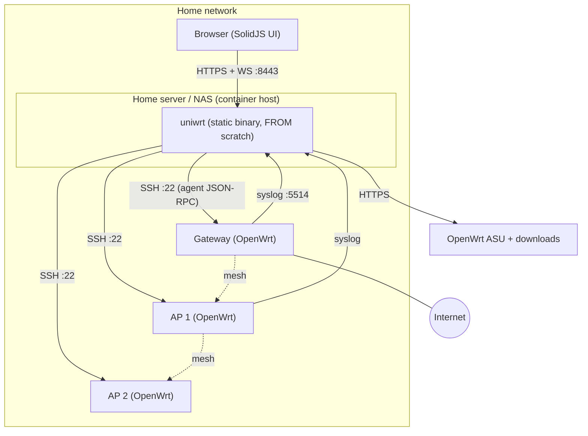

# Architecture

Read this when you touch crate boundaries, the node protocol, data flow, persistence or performance budgets. Feature-level design lives in [features/](features/).

## System context



## Principles

1. **Pure core, thin IO shell.** Rendering, diffing, planning and topology are pure functions over data: deterministic and snapshot-tested. IO lives only in adapter crates.
2. **Desired state in, transactions out.** There are no ad-hoc config changes. Every change goes through render → diff → review → transaction → verify.
3. **Data-plane independence.** The controller is never in the packet path, so the network keeps working while it is down. Steering and rollback fail safe.
4. **Capabilities over versions.** Render from detected capabilities (DSA vs swconfig, wpad variant, apk vs opkg), not from version strings.
5. **Explainable automation.** Every job step and automatic decision emits an event that includes its reason.
6. **One binary, zero runtime dependencies.** It runs in `FROM scratch`.

## Process structure (one binary)

- **HTTP server** (axum): REST under `/api/v1`, a WebSocket at `/api/v1/ws`, the embedded UI and the ZTP endpoints.
- **Engine:** one **NodeActor** (tokio task) per node. It follows the node's link and agent, keeps its live facts and status, sends its telemetry requests one at a time, and is restarted with backoff if it panics (D-037).
- **Event bus:** tokio broadcast of typed `Event`s. Consumers are the WS hub, the metrics writer, the alert engine and the store.
- **Job runner** (`jobs` crate): orchestrations on nodes (adopt, manage, unmanage and apply now, the apply moving RF plans' channels by a channel switch; upgrade, the nightly RF optimizer and backup later), each a task that saves the job at every step as history. Jobs do not resume: a restart marks the interrupted ones failed (D-042). One job at a time per target; an apply holds every managed node.
- **Store:** SQLite in WAL mode, with one batched writer task and a read pool.
- **Syslog receiver** (`syslog` crate): UDP and TCP listeners (5514; `--syslog-listen`) → parser → the engine's log recorder, which also stores what the agents follow (D-059), annotates, and announces stored entries for the WS topic `logs`.
- **Schedulers:** retention, backups, the RF optimizer, firmware checks and alert evaluation.

## Crates and layering

| Layer | Crate | Responsibility | May depend on |
|---|---|---|---|
| L0 pure | `core` | IDs, MAC/IP/prefix types, error conventions, `Clock` trait | — |
| L0 | `model` | desired state (`SiteConfig`), observed facts (`NodeFacts`, capabilities), the node record, validation, schema migrations | core, uci |
| L0 | `uci` | UCI AST, parser and serializer that match libuci (strict mode, checked against `uci` of each release), semantic diff and its apply, libuci's identifier rules (which `model` validates raw sections with) | — |
| L0 | `render` | (SiteConfig, secrets, role, facts, the node's current packages) → its managed UCI packages (system, network, wireless, dhcp, firewall), services and warnings; one VLAN-aware `br-lan` on every node (D-067) | core, model, uci |
| L0 | `import` | brownfield import (D-072): the nodes' UCI packages → the site's networks, WAN, firewall policy, DNS, WLANs, mesh and radios, each node's raw sections (whole, or merged into a rendered section) and the residual its first apply would change, with a confidence score | core, model, uci, render |
| L0 | `topo` | facts → topology graph | core, model |
| L0 | `clients` | the client inventory: vendors (embedded OUI table), device kinds, sessions, samples, experience score | core, model, topo |
| L0 | `metrics` | sampling facts, topology builds and client samples into 15 s windows; retention and the resolution a query reads; LTTB downsampling | core, model, topo, clients |
| L0 | `events` | deriving the event timeline from what the engine announces (conditions that raise and clear, folded repeats); alert rules over metric windows and recorded events, and the built-in rules (`data/alert-rules.toml`) | core, model, topo, clients |
| L0 | `rf` | RF insight: channel spans and overlap, occupancy per channel, the networks on each radio's channel, the inter-node RSSI matrix and radar history from scans and facts (M2.6); the channel/width/power planner (M6.1); a channel switch's `switch_chan` arguments (M6.1 b1b) | core, model |
| L0 | `isp` | ISP preset schema and embedded presets (`crates/isp/data/`) | core, model |
| L1 adapters | `store` | SQLite: revisions, inventory, events, jobs, metrics, logs (FTS5), vault | core, model |
| L1 | `node` | SSH transport (russh), agent protocol, `NodeLink` trait, embedded agent bundle, the transaction tool's commands and footprint (`txn`) | core, model |
| L1 | `syslog` | RFC 3164/5424 receiver and parser; log annotations (`log-patterns.toml`) | core, model |
| L1 | `firmware` | release catalog (ASU's overview and the download server's per-release device list, kept in memory), ASU client (zero-touch builds with the mesh essentials, D-104); image cache and verification later (M7) | core, model |
| L1 | `notify` | notifiers: alerts in words, rendered for ntfy, webhooks (Discord, Slack, Teams, Home Assistant, uniwrt's JSON, the user's template) and email; delivery over HTTP(S) (hyper, rustls, Mozilla's roots) and SMTP (lettre); the policy of what to send when (D-063) | core, model |
| L2 services | `engine` | node actors, telemetry ingest, live state and topology, event bus, alerts, schedulers | L0, L1 |
| L2 | `jobs` | orchestrations on nodes, kept as history: adopt (M1.7), manage and unmanage (M3.4a1), apply (M3.4a2a: plan, stage, apply, verify, confirm across the fleet), the WAN test (M4.1: a trial on the gateway, always rolled back), the speed test (M4.1b), the wpad swap (M5.2, D-089: the full wpad downloaded first, then swapped on the node by itself, offline, falling back to the old one), the apply's Channels round (M6.1 b1b, D-113: radios moved one node at a time by a channel switch); upgrade, the nightly RF optimizer, backup later | L0, L1 |
| L3 interface | `api` | axum REST + WebSocket, DTOs (ts-rs), auth and sessions | L0–L2 |
| L3 | `server` (bin `uniwrt`) | CLI, config, composition root, embedded UI, TLS | all |
| test | `sim` | simulated fleet implementing `NodeLink`: a seeded world rendered in the agent's raw shapes, and the commands the jobs run (adoption's, and the transaction tool with `/etc/config` in `uniwrt_sim::txn`, which the jobs' tests drive too; each node's `/etc/config` starts as OpenWrt 25.12's stock packages configured by hand for the simulated network, also exported with each node's facts as `uniwrt_sim::brownfield` for import's tests); the ISP behind the gateway, which answers what its `network` asks for (D-075); a factory-default gateway (`SimConfig::factory`, `serve --demo --demo-factory`; D-082) whose LAN follows its `network` when its ports bounce; `serve --demo` and tests (D-038, D-048) | core, model, node, uci |
| test | `system` | the system harness: rendered configs on OpenWrt containers through `docker exec` (the agent's facts, write and read back, netifd, the bridge); `tests/system.rs` on `scripts/test-system.sh`'s wired topology, and `tests/apply/` the apply job end to end there over a `docker exec` dial (M3.4a2b; jobs and store as dev-dependencies), `tests/wifi.rs` on the hwsim lab (M3.3b) | core, model, node, render, uci |

Rules:
- Dependencies point only to the same layer or a lower one.
- L0 crates do not depend on tokio and perform no IO.
- `just arch-check` (in `just check` and CI) reads this table and enforces it: every crate is in it, depends only on what its row allows (dev-dependencies may also use the test crates), and no row allows a higher layer; L0 crates have no async runtime, socket, database or SSH crate in their tree and no IO or clock reads in their source.
- A crate is created when its first WP starts, not before.
- `server` is the one crate outside the tests that depends on `sim`, for demo mode. The engine runs on its `FleetLink` enum (SSH or simulated), so the API has one engine type (D-038). Its `DemoDial` reaches the simulated nodes for the job runner, so demo mode adopts through the real adopt job and discovery (D-048).
- Packages are named `uniwrt-<crate>` (a library named `core` would shadow Rust's `core`); directories keep the short name.

## Node protocol (D-003: SSH + ephemeral ucode agent)

**Transport.** A russh client with an ed25519 controller key. The node's host key is pinned at adoption: `probe` reads it, the user confirms the fingerprint, and every connection checks the pin (D-032). Keepalive every 15 s, and 3 unanswered ones end the session; on disconnect, reconnect with jittered exponential backoff (1 s → 60 s). One connection per node carries multiplexed channels: the agent, ad-hoc exec, uploads and the browser terminal. Each channel is drained by its own task, so a slow reader cannot stall the others. Commands are argv arrays, quoted for the node's shell.

**Bootstrap on every connection** (`crates/node/src/bundle.rs`):
1. Run `cat /tmp/uniwrt/agent/VERSION`. If it isn't the embedded bundle's hash (the SHA-256 of its SHA256SUMS), stream the bundle, an uncompressed tar, through stdin into a fixed install script. The script makes `/tmp/uniwrt` root's and private, takes a `flock`, extracts into `.new`, checks every file with `sha256sum -c` and swaps the result in. Nothing depends on sftp or scp.
2. Open a long-lived channel running `ucode /tmp/uniwrt/agent/main.uc`.
3. The agent's first line is `{"hello":{"proto":1,"agent":"<hash>","release":"25.12.6","caps":{"events":true,"ops":[…],"sets":[…]}}}`. A hash other than the bundle's fails the start.

**Agent runtime (D-034).** With ucode-mod-uloop (in 25.12 images, and in Wi-Fi images since 23.05 through hostapd), a forked reader task feeds requests into an event loop, and each command runs in a task of its own. Without it, requests are served one at a time and the agent pushes no events. A command's output goes to files under `/tmp/uniwrt/run`, never to the agent's stdout. Collect sets return raw sources (ubus replies, sysfs text, `/proc` files), and the `node` crate parses them into `model::facts`. Under the event loop the agent also pushes (D-036): the ubus notifications of subscribed topics, its log in batches, and ticks of sets collected on a schedule, which `node::events` parses. Pushes end with the agent, so the engine asks for them again after each hello.

**Messages** are newline-delimited JSON:

```jsonc
// controller → agent
{"id":7,"op":"collect","args":{"sets":["system","stations"]}}
{"id":8,"op":"ubus","args":{"path":"hostapd.phy1-ap0","method":"rrm_nr_set","data":{"list":[]}}}
{"id":9,"op":"exec","args":{"argv":["batctl","o"],"timeout_ms":5000}}
{"id":10,"op":"subscribe","args":{"topics":["hostapd","netifd","dhcp","usteer"]}}
{"id":11,"op":"set_interval","args":{"interval_ms":2000,"sets":["radios","stations"]}}
// agent → controller
{"id":7,"ok":{}}
{"id":9,"err":{"code":"timeout","msg":"batctl did not exit within 5000 ms"}}
{"ev":"hostapd.assoc","ts":1761091200123,"data":{"address":"aa:bb:cc:dd:ee:ff","ifname":"phy1-ap0","signal":-52,"freq":5180}}
{"tick":{"sets":{"radios":{},"stations":{}},"errors":{}}}
```

- **Ops:** `hello`, `ping`, `collect`, `ubus`, `exec` (an argv array with a timeout and bounded output), `read_file` (M1.3); `subscribe`/`unsubscribe`, `log_follow`, `set_interval` (M1.3c, event loop only; D-036); `bss` (M5.1, D-083: a phy's BSSes off and on through hostapd's `config_set`, for WLAN schedules); `ban` (M5.1, D-084: clients kept off every BSS for a while, or let back, through hostapd's `del_client`, for kicks and blocks); `rrm` (M5.2: each BSS's own 802.11k neighbor report through hostapd's `rrm_nr_get_own`, and the lists the controller ranks through `rrm_nr_set`, left alone where `rrm_nr_list` holds them already); `btm` (M5.2, D-093: a BSS transition request to one client from the BSS it is on, with the MBO fields and an optional disconnect timer, for steering); `mtu` (M5.3, D-094: the wired backhaul's probe, BusyBox's ping of the all-nodes group on a cable's VLAN device at batman-adv's 1532 bytes, answering the device's MTU and the link-local peers that replied; a device below the size isn't pinged). Transactions don't go through the agent: the controller runs the transaction tool (`/etc/uniwrt/txn`) over exec (D-069), since the agent dies with the session a reload may cut. Failures carry a code: `bad_request`, `not_found`, `timeout`, `too_large`, `denied`, `unsupported` or `failed`.
- **Source of truth:** `crates/node/src/proto.rs` and `proto/ops.rs`, mirrored by `node-agent/proto.uc` and `ops.uc`. The `proto` integer bumps on breaking changes; the controller supports the current version and the previous one.
- **Jump hosts:** a `direct-tcpip` channel through an adopted node reaches isolated segments, such as the adoption port described in features/adoption.md.

**Node footprint:**

| Mode | Persistent changes on the node |
|---|---|
| Observe | One `authorized_keys` entry (comment `uniwrt-controller`). Remote syslog only with consent. |
| Managed | Adds `/etc/uniwrt/` (the transaction tool `txn` and its `VERSION`; `journal/` with the open transaction's snapshot and the last outcome, ≤ 100 KB), `/etc/init.d/uniwrt-guard` (START=13: rolls back an unconfirmed transaction at boot; runs the open one's dead-man timer and reload as procd instances), `/lib/upgrade/keep.d/uniwrt` (keeps both across sysupgrade), and the managed UCI packages (D-069). |

Everything else is ephemeral, under `/tmp/uniwrt` (RAM).

## Data flows

- **Telemetry:** the agent's ticks and events → the `node` crate parses them into `model::facts` → the NodeActor updates live state → the event bus fans out to the WS hub (at most 10 deltas/s per topic), the batched metrics writer, the alert engine and the snapshot writer.
- **Change:** UI edits → a staged `SiteConfig` revision → pure render per node → semantic diff against a freshly fetched node config → review → apply job (ordered per-node transactions) → verify over a new SSH connection, with health checks → confirm → events. Details: features/lifecycle.md.

## Persistence

- One SQLite database in WAL mode at `/data/uniwrt.db` (mode 0600), owned by the `store` crate (D-031). One writer thread holds the only write connection and commits queued operations in batches of up to 256, each in its own savepoint so that a failing one rolls back alone; callers get their result once the batch commits. Reads use up to 4 read-only connections on tokio's blocking pool. With `synchronous=NORMAL`, a power loss may drop the last commits but never corrupts the database.
- Tables (sketch; ✓ = exists): `users` ✓, `sessions` ✓ (by token hash), `audit` ✓, `api_tokens`, `settings` ✓ (by key, JSON), `vault` ✓, `topology_history` ✓ (keyframes and deltas, 24 h; D-052), `topology_layout` ✓ (pinned vertices) (secrets, each sealed with XChaCha20-Poly1305 under the master key; features/security.md), `node_host_keys` ✓ (the pinned SSH host key per node), `revisions` ✓ (SiteConfig JSON in its schema, its diff from the parent, author and message; D-065), `node_applied` ✓ (the revision each node holds; D-070), `node_config` ✓ (each managed package as an apply confirmed it on its node, drift's baseline), `config_drift` ✓ and `drift_mutes` ✓ (D-074), `backhaul_failures` ✓ (cables that failed the wired backhaul's probe; D-097), `nodes` ✓, `node_facts` ✓ (the latest NodeFacts JSON per node), `node_inventory` ✓ (the packages, read at adoption), `node_backups` ✓ (`sysupgrade -b` tarballs, sealed like secrets; D-042), `node_configs` (last fetched UCI per package + hash), `clients` ✓, `client_sessions` ✓ (association and roam history; D-053), `events` ✓ (the timeline: JSON per event, its condition, folded repeats; D-061), `jobs` ✓ (history, steps as JSON; D-042), `metric_series` ✓, `metrics_raw` ✓ (15 s windows, 48 h), `metrics_1m` ✓ (14 d) and `metrics_1h` ✓ (400 d) with min/mean/max/last and their weight, `metric_rollups` ✓ (how far each rollup got; D-056), `logs` ✓ + `logs_fts` ✓ (contentless FTS5 over program and text, rows deleted with their entries), `log_sources` ✓ (hosts and programs, for filters), `log_searches` ✓ (D-059), `alert_rules` ✓, `alerts` ✓ and `maintenance_windows` ✓ (D-062), `notifiers` ✓ (specs and filters without their secrets, which the vault keeps as `notifier/<id>`, and how deliveries went; D-063), `firmware_cache`, `ztp_pending` ✓ and `ztp_approvals` ✓ (the ZTP inbox and pre-approvals by MAC; D-102).
- Migrations are embedded from `crates/store/migrations/NNNN_name.sql`, forward-only (tracked in `PRAGMA user_version`; a database from a newer uniwrt is refused) and tested. A released migration is never edited.
- Files: `/data/firmware/`, `/data/master.key` (mode 0600; or `UNIWRT_MASTER_KEY_FILE`, or the key itself in `UNIWRT_MASTER_KEY`). The local CA and the HTTPS certificate live in the vault (D-039).

## API

- REST JSON under `/api/v1`: auth, site, revisions, changes (pending/review/apply), nodes, clients, networks, wlans, topology, metrics, logs, events, jobs, firmware, isp-presets, tools, settings.
- Errors use RFC 9457 problem+json. Pagination is cursor-based.
- Auth: a session cookie for the UI, or (later) a bearer API token for scripts. Public routes: `/api/v1/health`, `/api/v1/tls` (the certificate's names and the CA's fingerprint), `/api/v1/tls/ca.crt`, `/api/v1/auth` (setup state and the session's user), `/api/v1/auth/setup` and `/api/v1/auth/login`; everything else needs a session (features/security.md).
- State-changing requests carry `X-Uniwrt-Csrf: 1`; responses are `Cache-Control: no-store`. The `api` crate owns the routes and security headers; the server nests them under `/api`, serves the UI as the fallback, and tells the API who each client is (`Client`).
- HTTPS serves everything (8443). Plain HTTP (8080) redirects to it, except the health check and requests from `--trusted-proxies`, which get the whole application (D-039).
- Nodes (M1.6c): `GET /api/v1/nodes` (summaries) and `GET /api/v1/nodes/{id}` (record, status, facts). The API reaches the engine through `uniwrt_engine::Fleet`, its link-free face (D-041).
- Topology (M2.1): `GET /api/v1/topology`, the engine's latest build (features/observability.md, Topology; D-051); the WS topic `topology` keeps it current with deltas. Its replay (M2.2): `GET /api/v1/topology/timeline` (how far back the history goes, and its changes) and `GET /api/v1/topology/at/{ms}`; its layout: `GET /api/v1/topology/layout`, `PUT` and `DELETE /api/v1/topology/layout/{vertex}`, and `DELETE /api/v1/topology/layout` (D-052).
- Clients (M2.3): `GET /api/v1/clients`, `GET` and `PATCH /api/v1/clients/{mac}` (the detail; a rename by an admin, audited) and `GET /api/v1/clients/{mac}/sessions?since=<ms>`; WS topics `clients` and `client:<mac>` (D-053).
- Adoption and jobs (M1.7): `POST /api/v1/adopt/probe` (the node's host key, for the user to confirm), `POST /api/v1/adopt` (202 with the job; audited), `GET /api/v1/jobs` and `GET /api/v1/jobs/{id}` (D-042).
- Logs (M2.5a): `GET /api/v1/logs` (a filter: `nodes`, `hosts`, `programs`, `min`, `q` full text, `annotated`, `from`, `to`; pages newest first with a `before=<time>:<id>` cursor), `GET /api/v1/logs/histogram` (counts by severity per bucket), `GET /api/v1/logs/{id}/context?around=<n>` (across all sources), `GET /api/v1/logs/sources`, `GET /api/v1/logs/patterns` (what annotations mean), and saved searches shared by all users: `GET` and `POST /api/v1/logs/searches`, `DELETE /api/v1/logs/searches/{id}` (D-059). The WS topic `logs` sends the newest 200 stored entries, then each stored one that passes its filter.
- Notifiers (M2.5b2b): `GET` and `POST /api/v1/notifiers`, `PUT` and `DELETE /api/v1/notifiers/{id}` (admins; audited; secrets in, never out: only which are set), `POST /api/v1/notifiers/test` (a test through a notifier as given, 502 with why on failure), `PUT /api/v1/notifications/settings` (the address messages link to) (D-063).
- Site and revisions (M3.1a): `GET` and `PUT /api/v1/site` (the latest document; a save names its base revision, 409 when stale, 422 with issues by path when invalid; secrets in by path, out only as references and which are set), `POST /api/v1/site/secrets/reveal` (admins; audited), `GET /api/v1/revisions` (pages newest first, `before=<id>`), `GET /api/v1/revisions/{id}`, `GET /api/v1/revisions/{id}/diff?against=<id>`, `POST /api/v1/revisions/{id}/restore` (D-065). Problems with a document carry `issues` (`path`, `severity`, `message`).
- Events (M2.5b1): `GET /api/v1/events` (a filter: `categories`, `min` level, `nodes`, `clients`, `from`, `to`; pages newest first with a `before=<time>:<id>` cursor). The WS topic `events[?node=<id>&min=<level>]` sends the newest 100, then each one recorded or folded that passes (D-061).
- WebSocket `/api/v1/ws`: each `{"sub":["fleet","node:<id>","logs?node=<id>&min=warning","events?min=notice","jobs","topology","clients","client:<mac>","rf","config"]}` replaces the connection's topics. The server answers each new topic with a snapshot, then deltas merged per topic and flushed at most every 100 ms; messages are tagged by `type` and name their topic. Holding `node:<id>` raises that node's telemetry rate (adaptive polling). `config` sends the site's latest revision and the revision each node holds, whole, again after every save, restore and apply that ends; when a job on nodes ends, `fleet` and `node:<id>` read those nodes' records again (their mode, their address; D-071). The upgrade is a GET over HTTP/1.1 and an extended CONNECT over HTTP/2 (RFC 8441); it needs a session and our `Origin`, and the connection closes with 4401 when the session ends (D-041).
- Types: Rust DTOs derive `TS` with `#[ts(export)]`, and `cargo test` (or `just gen`) writes them and the types they use to `web/src/api/gen/`. The `core` and `model` types derive `TS` behind their `ts` feature, which only `api` enables. JSON keeps the Rust field names (snake_case).

## Performance budgets

| Area | Budget |
|---|---|
| Controller memory | idle RSS ≤ 60 MB with 10 nodes / 200 clients |
| Controller CPU | ≤ 2% of one Raspberry Pi 4 core at idle |
| Binary | ≤ 25 MB static; cold start < 1 s |
| API | p99 < 50 ms; node event → UI < 300 ms |
| UI | initial JS ≤ 150 KB gzip; 60 fps topology with 300 entities |
| Node agent | RSS ≤ 4 MB; ≤ 1% CPU on an MT7621-class router at the 15 s base interval |

## Failure modes

| Failure | Behavior |
|---|---|
| Controller down | The network is unaffected and steering stops changing. TCP syslog reconnects; nodes resync when the controller returns. |
| SSH session drops | The actor reconnects. In-flight RPCs fail fast and the telemetry gap is flagged in the UI. |
| An apply breaks connectivity | The node rolls back itself when the dead-man timer expires; the job rolls back the others and fails (D-070). |
| Node reboots mid-transaction | The boot guard restores the snapshot. |
| Host key changes | The node is quarantined and an alert is raised; an admin must re-trust it. |
| Telemetry stops while the link is up | After three of its fastest intervals (at least 30 s) the node is degraded, and the engine asks the agent for its pushes again (D-037). |
| ucode is too old or modules are missing | Degraded mode: basic collection through exec, and the UI shows the reason. |
| Clock skew | Node and controller timestamps are both kept. NTP on nodes is managed. |

Security architecture: [features/security.md](features/security.md).
